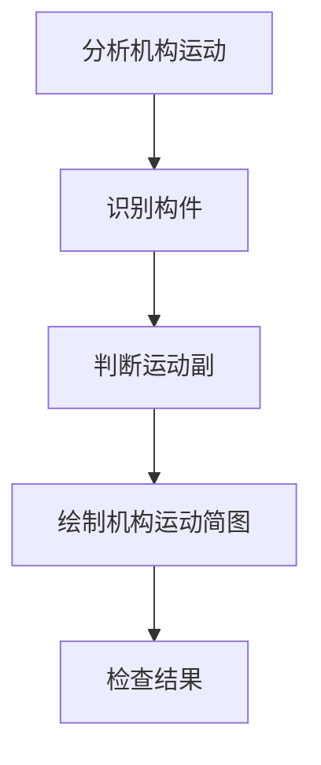

# 机械设计基础：机构分析

整篇复制到 ClassNote 正文，或通过“导入笔记”粘贴预览。图形必须使用 `mermaid` 或 `svg` 语言标记；`css`、`arduino` 等普通代码块保持源码。

## 学习重点

**构件**是运动单元，*运动副*限制构件之间的相对运动。

- 识别机架与活动构件
- 检查运动副类型
1. 绘制简图
2. 计算自由度

- [ ] 能够识别构件
- [x] 已复习运动副

> 先理解机构，再使用公式。

### 公式与表格

牛顿第二定律：$F=ma$。

$$F=3n-2P_L-P_H$$

| 符号 | 含义 |
| --- | --- |
| $n$ | 活动构件数 |
| $P_L$ | 低副数 |

## 分析流程



## 连杆示意图

```svg
<svg xmlns="http://www.w3.org/2000/svg" viewBox="0 0 300 120">
  <line x1="50" y1="60" x2="250" y2="60" stroke="currentColor" stroke-width="3"/>
  <circle cx="50" cy="60" r="8" fill="none" stroke="currentColor" stroke-width="2"/>
  <circle cx="250" cy="60" r="8" fill="none" stroke="currentColor" stroke-width="2"/>
  <text x="150" y="35" text-anchor="middle" fill="currentColor">连杆示意图</text>
</svg>
```

## 普通代码

```python
mobility = 3 * n - 2 * lower_pairs - higher_pairs
```

普通图片可使用 ``。Mermaid 与 SVG 源码会随笔记保存；远程图片的可用性取决于原链接。

图形的“查看源码”用于编辑；“适合宽度 / 100% / 150%”用于缩放，宽图可在图形区域内滚动。SVG 支持静态图形及属性配色，不支持脚本、动画、外部图片、foreignObject 和自定义 CSS；Mermaid 不接受配置指令与外部图片节点。
